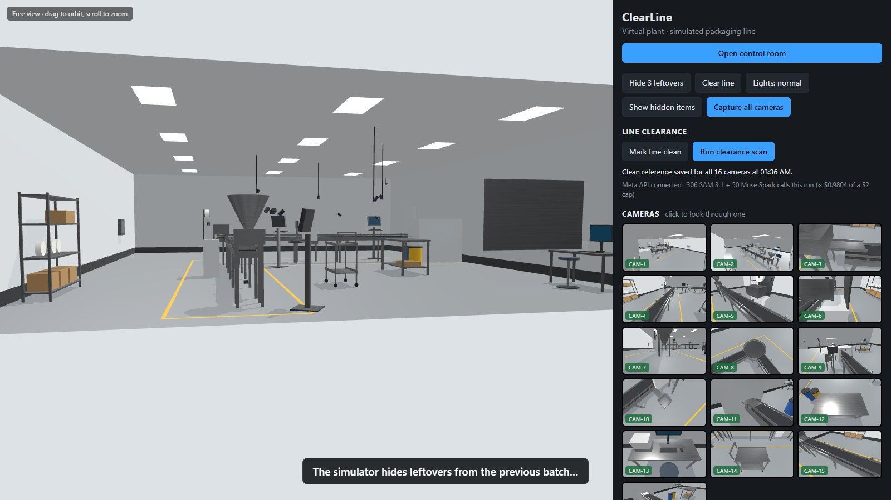
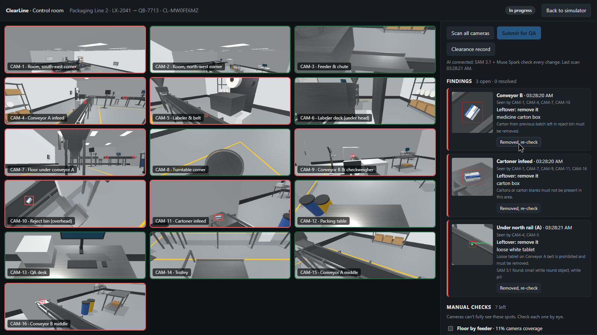
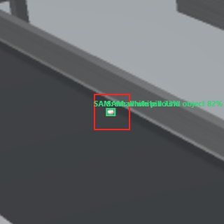
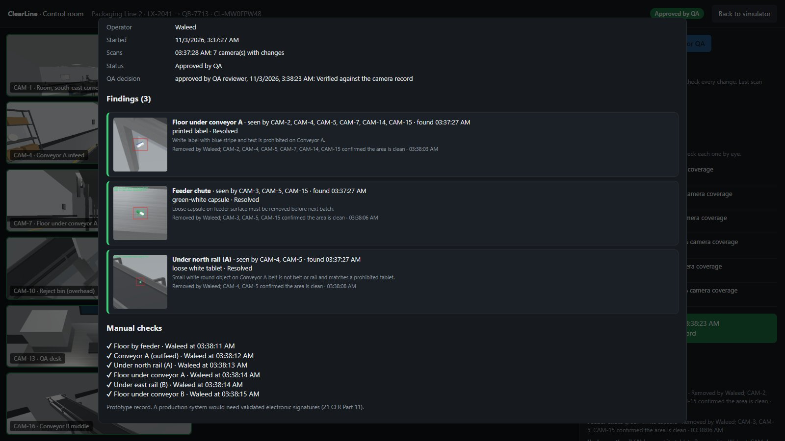
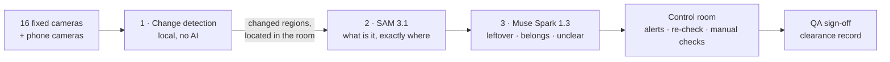

# ClearLine

**AI line clearance for pharmaceutical packaging lines, powered by Meta SAM 3.1 and Muse Spark.**

Fixed cameras watch the line. When something is left behind from the previous batch, SAM 3.1 outlines it,
Muse Spark judges it against the area's checklist, operators remove and re-check, and QA signs a timestamped record.

▶ **[Watch the 2-minute demo](https://github.com/WaleedOH/clearline/releases/download/v1.0/clearline-demo.mp4)**
· [Results on the live Meta models](#results-on-the-live-meta-models) · [Try it in two minutes](#try-it-in-two-minutes)

> Built for the **Meta Global AI Developer Hackathon** (Oct 26 – Nov 4, 2026), indie track, theme *Build for Your World*.
> Everything in this repository was created during the hackathon.

| The virtual plant: 16 cameras on an L-shaped line | The control room: one alert per object, every camera that sees it |
|---|---|
|  |  |

| What the AI saw: the change in red, SAM 3.1's outline in green | The clearance record QA signs |
|---|---|
|  |  |

## The problem

I work in pharmaceutical manufacturing. Before a new batch starts on a packaging line, GMP requires a
*line clearance*: proof that nothing from the previous batch is left behind. No stray tablets, capsules, labels,
vials or cartons. Today it is done by eye: typically about an hour of operator time plus an hour of QA
oversight per clearance, and a single missed tablet can mean a product mix-up, a quality notification and lost
production. Nothing on the line catches a clearance failure; people do.

## How it works



1. **Change detection (no AI).** Every camera keeps a picture of the line when it was last confirmed clean.
   A scan compares the live frame with it and marks what changed. Because the cameras are calibrated, each
   change is located in the room, and the same object seen by several cameras becomes **one** alert.
2. **SAM 3.1: what and where.** A tablet is 6–15 pixels in a full frame, too small for any model. ClearLine
   crops the changed patch with some context, enlarges it up to 6×, and asks SAM 3.1 for six short phrases
   (*white pill, small white round object, two-colour capsule pill, printed paper label, small glass vial,
   small rectangular package*). SAM returns a box and a pixel-exact outline for each match, with a confidence.
3. **Muse Spark: does it matter?** Muse Spark gets the crop with the change outlined, SAM's findings, and the
   area's checklist (what belongs there, what must not be present). It answers in a fixed format: *leftover*,
   *belongs* or *unclear*, the item, and one sentence for the operator. Its instructions say that anything on
   the must-not list is a leftover however small, and that it must answer *unclear* rather than guess
   *belongs*; a false alarm is cheaper than a missed tablet.
4. **Closing the loop.** When the operator removes an item, every camera that saw it re-compares against its
   clean picture; the alert only closes when the patch is gone. Spots the cameras cannot fully see are measured
   and listed as manual checks. QA reviews the findings, photos, actions and manual checks, then approves or
   rejects, and the whole run is a timestamped clearance record.

**Meta models used, and where they run:** `sam-3.1` and `muse-spark-1.3`, both called through the
**Meta Model API** (`api.meta.ai`) from the local server in [`server/`](server). No other AI models are used.

## Results on the live Meta models

End-to-end run on the Meta Model API, Nov 3 2026: 10 random clearances, 3 leftovers each, judged against where
the simulator actually put them. `window.clearline.evaluateEndToEnd(10, 3)` in the browser console reruns it.

| | Count |
|---|---|
| Leftovers hidden | 30 |
| Visible to at least one camera | 28 (the other 2 sat in listed blind spots → manual check) |
| Raised by change detection | 28 of 28 |
| Confirmed **leftover** by SAM 3.1 + Muse Spark | **26 of 28** |
| Flagged **unclear** (operator checks by eye) | 2 of 28 |
| Dismissed as "belongs" (a miss) | **0** |
| False alarms | 3, all specks marked "unclear", none marked "leftover" |
| AI errors | 0 |
| Average scan, 16 cameras | about 20 s |
| Cost per clearance | about $0.06 |

By item type: capsules 7/7, labels 7/7, cartons 1/1, vials 7/8 (1 unclear), tablets 4/5 (1 unclear).
Stage 1 alone (change detection, no AI) caught 106 of 106 visible items with 0 false alarms over 30 random
scenarios, and a phone camera on a real surface raised a single mint with no noise alarms.

### What tuning on the live models taught us

- SAM 3.1 wants descriptive phrases: *"tablet"* found nothing, *"white pill"* found it at 59–71 % and
  *"small white round object"* at 82 %. Cartons needed *"small rectangular package"*.
- Zooming in matters: a 15-pixel tablet was found more confidently at 6× than at 4×.
- The API has a burst limit: four parallel SAM calls still tripped it, so ClearLine keeps two in flight and
  retries with increasing waits. If SAM is unavailable, Muse Spark still judges from the picture alone.
- Muse Spark at low reasoning effort answers an inspection question in 3–7 s instead of 15–25 s, with the same
  verdicts.

## Try it in two minutes

Requires Node.js 20 or newer. Works without an API key (changes are flagged for a person to check).

```bash
git clone https://github.com/WaleedOH/clearline.git
cd clearline
npm install
npm run dev
```

Open the address it prints, then:

1. **Hide 3 leftovers**, then **Show hidden items** to see where they went (red pins). Click any camera tile
   to look through it.
2. **Open control room**, enter a name and **Start clearance & scan**.
3. Work through the findings: **Removed, re-check** makes the cameras confirm the spot is clean. Tick the
   manual checks, **Submit for QA**, approve, and open the **Clearance record**.

To use Meta's models, copy `.env.example` to `.env` and add your Meta Model API key. `SPEND_LIMIT_USD` stops
every call to Meta's models once the estimated spend for the run reaches it ($2 by default; a clearance costs
about $0.06). The key stays on the server; the browser never sees it.

### Phone cameras

```bash
npm run dev:phone
```

Serves ClearLine over HTTPS on the local network (phones only allow camera access on secure pages; the
certificate is self-signed, so each device asks to trust it once). The control room shows the phone address and a
4-digit join code. On the phone: open the address, enter the code, prop it up facing the area, then press
**Set clean picture** on its tile while the area is clean. The clean picture is learned over a few seconds,
including how much each pixel flickers, so small items are caught without noise alarms; a bumped camera gives a
warning instead of false alerts. Only phone picture uploads are accepted from the network; everything else,
including every call that spends credits, answers the computer running ClearLine only.

### Testing the AI path offline

[`scripts/meta-stand-in.mjs`](scripts/meta-stand-in.mjs) is a local stand-in for the Meta Model API. It checks
requests have the documented shape and answers in the documented formats with fixed, fake results, so the pipeline
can be exercised without credits. The control room shows a red "TEST STAND-IN" warning whenever it is in use.

```bash
npm run stand-in
META_API_BASE=http://localhost:5199/v1 MODEL_API_KEY=test npx vite --port 5180
```

## Project structure

| Path | What it is |
|---|---|
| [`src/plant/`](src/plant) | The virtual plant: room and L-shaped line, leftover simulator, calibrated cameras, ground truth |
| [`src/pipeline/change.ts`](src/pipeline/change.ts) | Stage 1: change detection with learned per-pixel noise |
| [`src/pipeline/analyze.ts`](src/pipeline/analyze.ts) | Stages 2–3: crop and enlarge, SAM 3.1, Muse Spark, evidence thumbnails |
| [`src/pipeline/checklists.ts`](src/pipeline/checklists.ts) | Per-area checklists, camera-to-area map, SAM prompts |
| [`src/ui/controlRoom.ts`](src/ui/controlRoom.ts) | Control room: camera grid, multi-camera fusion, findings, manual checks, QA, record |
| [`src/clearance/run.ts`](src/clearance/run.ts) | The clearance run model and its history |
| [`src/phone/`](src/phone) | Phone camera page and feeds |
| [`server/`](server) | Local API: Meta key, SAM 3.1 and Muse Spark clients, spend cap, phone uploads |
| [`src/main.ts`](src/main.ts) | Wires it together, plus the evaluation runners (`evaluateChangeDetection`, `evaluateEndToEnd`) |

Stack: TypeScript, Three.js, Vite. No database, no cloud: the whole system runs on one computer, which is how
a plant would want it; only the AI calls leave the building.

## Limits and what's next

- This is a simulated room. Real-plant lighting, reflections and camera noise will differ; the phone camera
  path exists for that and is the next thing to validate on a physical mock line.
- The clearance record is a prototype, not a validated 21 CFR Part 11 system with electronic signatures.
- Next: SAM 3.1 video tracking for continuous watching between scans, and Muse Voice Transcribe for
  hands-free "removed, re-check" from gloved operators.

## Credits and disclosures

Built by Waleed during the hackathon with the help of AI coding assistants. The demo video's narration is a
synthetic voice reading my script. All product names, batch numbers and line layouts are fictional; no real
plant data was used.

## License

MIT
